# Đề xuất chiến lược tái phát triển MISA Ghi Chú thành MISA Note

**44 slide · 4 phần**

## Mục lục
| Phần | Slide |
| --- | --- |
| Mở đầu | 1 |
| Phần I: Đánh giá hiện trạng AMIS Ghi Chép | 2–4 |
| Phần II: Nghiên cứu thị trường và đối thủ cạnh tranh | 5–11 |
|  | 12–13 |
| Phần II: Nghiên cứu thị trường và đối thủ cạnh tranh | 14–14 |
|  | 15–15 |
| Phần II: Nghiên cứu thị trường và đối thủ cạnh tranh | 16–26 |
| Phần III: Phân tích năng lực cạnh tranh và cơ hội phát triển | 27–35 |
| Phần IV: Chiến lược và lộ trình phát triển sản phẩm | 36–44 |

---
## Slide 01 — MISA NOTE
Từ ghi chú đến tri thức dùng được
**Phần:** ĐỀ ÁN TÁI PHÁT TRIỂN

### Phần I

Đánh giá hiện trạng AMIS Ghi Chép

### Phần II

Nghiên cứu thị trường và đối thủ cạnh tranh

### Phần III

Phân tích năng lực cạnh tranh và cơ hội phát triển

### Phần IV

Chiến lược và lộ trình phát triển sản phẩm

ĐỀ XUẤT CHIẾN LƯỢC TÁI PHÁT TRIỂN MISA GHI CHÚ THÀNH MISA NOTE

---
## Slide 02 — Phần I: Đánh giá hiện trạng AMIS Ghi Chép
**Phần:** Phần I: Đánh giá hiện trạng AMIS Ghi Chép

### Phạm vi

Đánh giá mức độ đáp ứng nhu cầu sử dụng, nhận diện các hạn chế về trải nghiệm và quản lý thông tin, từ đó xác lập cơ sở cho việc tái phát triển sản phẩm.

**Ghi chú thuyết trình:**

Phần I: Đánh giá hiện trạng AMIS Ghi Chép

Phạm vi
Đánh giá mức độ đáp ứng nhu cầu sử dụng, nhận diện các hạn chế về trải nghiệm và quản lý thông tin, từ đó xác lập cơ sở cho việc tái phát triển sản phẩm.

---
## Slide 03 — AMIS Ghi Chép chưa đáp ứng đầy đủ nhu cầu quản lý thông tin
**Phần:** Phần I: Đánh giá hiện trạng AMIS Ghi Chép

### 1. Hạn chế trong việc tạo lập và quản lý nội dung

- Người dùng chủ yếu tiếp nhận tài liệu được cung cấp sẵn, chưa thể chủ động tạo và quản lý ghi chú cá nhân.
- Chưa hình thành được không gian làm việc để người dùng tự tổ chức và cập nhật thông tin theo nhu cầu.
Tác động: Phạm vi sử dụng còn hạn chế, chưa trở thành công cụ hỗ trợ công việc thường xuyên.

### 2. Khó khăn trong việc tìm kiếm và khai thác tài liệu

- Khả năng tìm kiếm chưa đáp ứng tốt nhu cầu tra cứu thông tin.
- Người dùng phải mất nhiều thao tác để xác định tài liệu hoặc nội dung cần tìm.
Tác động: Giảm hiệu quả tiếp cận và tái sử dụng thông tin, đặc biệt khi số lượng tài liệu tăng lên.

### 3. Trải nghiệm chia sẻ và phân quyền chưa thuận tiện

- Sản phẩm đã có tính năng phân quyền nhưng cách thể hiện và thao tác chưa đủ trực quan.
- Người dùng gặp khó khăn khi xác định phạm vi chia sẻ và quyền truy cập phù hợp.
Tác động: Làm giảm sự thuận tiện trong chia sẻ và phối hợp sử dụng tài liệu.

AMIS Ghi Chép hiện mới đáp ứng một phần nhu cầu tiếp nhận thông tin, chưa hỗ trợ đầy đủ quá trình tạo lập, quản lý và khai thác tri thức trong công việc.

**Ghi chú thuyết trình:**

AMIS Ghi Chép chưa đáp ứng đầy đủ nhu cầu quản lý thông tin

1. Hạn chế trong việc tạo lập và quản lý nội dung
• Người dùng chủ yếu tiếp nhận tài liệu được cung cấp sẵn, chưa thể chủ động tạo và quản lý ghi chú cá nhân.
• Chưa hình thành được không gian làm việc để người dùng tự tổ chức và cập nhật thông tin theo nhu cầu.
Tác động: Phạm vi sử dụng còn hạn chế, chưa trở thành công cụ hỗ trợ công việc thường xuyên.

2. Khó khăn trong việc tìm kiếm và khai thác tài liệu
• Khả năng tìm kiếm chưa đáp ứng tốt nhu cầu tra cứu thông tin.
• Người dùng phải mất nhiều thao tác để xác định tài liệu hoặc nội dung cần tìm.
Tác động: Giảm hiệu quả tiếp cận và tái sử dụng thông tin, đặc biệt khi số lượng tài liệu tăng lên.

3. Trải nghiệm chia sẻ và phân quyền chưa thuận tiện
• Sản phẩm đã có tính năng phân quyền nhưng cách thể hiện và thao tác chưa đủ trực quan.
• Người dùng gặp khó khăn khi xác định phạm vi chia sẻ và quyền truy cập phù hợp.
Tác động: Làm giảm sự thuận tiện trong chia sẻ và phối hợp sử dụng tài liệu.

AMIS Ghi Chép hiện mới đáp ứng một phần nhu cầu tiếp nhận thông tin, chưa hỗ trợ đầy đủ quá trình tạo lập, quản lý và khai thác tri thức trong công việc.

---
## Slide 04 — Hạn chế hiện tại đang cản trở giá trị sử dụng và khả năng mở rộng
**Phần:** Phần I: Đánh giá hiện trạng AMIS Ghi Chép

### 1. Khó trở thành công cụ hằng ngày

Chủ yếu đọc tài liệu có sẵn, chưa hỗ trợ đầy đủ ghi chép cá nhân.
Hệ quả: Ít lý do quay lại, khó hình thành thói quen sử dụng.

### 2. Tri thức chưa được khai thác tốt

Tìm kiếm, tổ chức và chia sẻ còn bất tiện.
Hệ quả: Mất thêm thời gian tìm, hỏi và tổng hợp lại thông tin đã có.

### 3. Chưa sẵn sàng mở rộng thị trường

Nhu cầu cơ bản chưa được đáp ứng tốt, giá trị khác biệt chưa rõ.
Hệ quả: Cần hoàn thiện nội bộ trước khi thương mại hóa.

Tái phát triển để người dùng chủ động tạo lập, tổ chức, chia sẻ và khai thác tri thức — tạo giá trị nội bộ trước, mở rộng thị trường sau.

**Ghi chú thuyết trình:**

Những hạn chế hiện tại đang giới hạn giá trị và tiềm năng phát triển sản phẩm

1. Giá trị sử dụng chưa đủ toàn diện
Khi sản phẩm chủ yếu phục vụ việc đọc và tra cứu tài liệu có sẵn, người dùng chưa có nhiều lý do để sử dụng thường xuyên cho các hoạt động ghi chép và quản lý thông tin cá nhân.
Hệ quả: Khó hình thành thói quen sử dụng hằng ngày và mở rộng phạm vi ứng dụng trong nội bộ.

2. Hiệu quả khai thác tri thức còn hạn chế
Tài liệu đã được lưu trữ nhưng việc tìm kiếm, tổ chức và chia sẻ chưa thực sự thuận tiện, khiến giá trị của thông tin chưa được khai thác tối đa.
Hệ quả: Người dùng có thể phải dành thêm thời gian tìm kiếm, trao đổi hoặc tổng hợp lại những thông tin đã tồn tại.

3. Chưa tạo được lợi thế đủ rõ để mở rộng thị trường
Các nền tảng ghi chú hiện đại đang cung cấp trải nghiệm quản lý thông tin linh hoạt, phối hợp và khai thác tài liệu bằng AI. Trong khi đó, AMIS Ghi Chép vẫn còn những hạn chế ngay ở các nhu cầu sử dụng cơ bản.
Hệ quả: Sản phẩm cần được hoàn thiện và xác lập giá trị khác biệt trước khi xem xét thương mại hóa.

Định hướng cần giải quyết: Chuyển AMIS Ghi Chép từ công cụ cung cấp và tra cứu tài liệu thành nền tảng cho phép người dùng chủ động tạo lập, tổ chức, chia sẻ và khai thác thông tin hiệu quả.
Việc tái phát triển cần kế thừa những chức năng đang đáp ứng tốt nhu cầu, đồng thời ưu tiên cải thiện các điểm hạn chế trực tiếp ảnh hưởng đến trải nghiệm và giá trị sử dụng.

Tái phát triển AMIS Ghi Chép không đơn thuần là bổ sung tính năng, mà là bước cần thiết để nâng cao giá trị sử dụng nội bộ và tạo nền tảng cho khả năng cạnh tranh, thương mại hóa trong tương lai.

---
## Slide 05 — Phần II: Nghiên cứu thị trường và đối thủ cạnh tranh
**Phần:** Phần II: Nghiên cứu thị trường và đối thủ cạnh tranh

### Phạm vi

Phân tích xu hướng phát triển, cách tiếp cận sản phẩm và giá trị kinh doanh của các ứng dụng ghi chú, phối hợp và khai thác tri thức bằng AI.

---
## Slide 06 — Notion AI, Gemini Notebook và Lark: 3 sản phẩm nổi bật
**Phần:** Phần II: Nghiên cứu thị trường và đối thủ cạnh tranh

Ba sản phẩm được nghiên cứu theo ba hướng tiếp cận: tổ chức công việc, khai thác tri thức từ tài liệu và phối hợp trong doanh nghiệp.

### Notion AI

- Kiến trúc sư và người điều phối.
- Vai trò: Hệ điều hành cho công việc và phối hợp nhóm.
- Chức năng: Quản lý dự án, xây dựng Wiki nội bộ, giao tiếp nhóm, chia sẻ tài liệu và theo dõi tiến độ công việc.

### Gemini Notebook

- Trợ lý nghiên cứu dựa trên nguồn.
- Vai trò: Phân tích, tổng hợp và khai thác tri thức.
- Chức năng: Hỏi đáp có trích dẫn; tạo nội dung, học liệu và bảng dữ liệu bằng AI.

### Lark

- Hệ sinh thái cơ bản.
- Vai trò: Hệ sinh thái điều hành cho công việc
- Chức năng: Giao tiếp nhóm, chia sẻ tài liệu và theo dõi tiến độ công việc

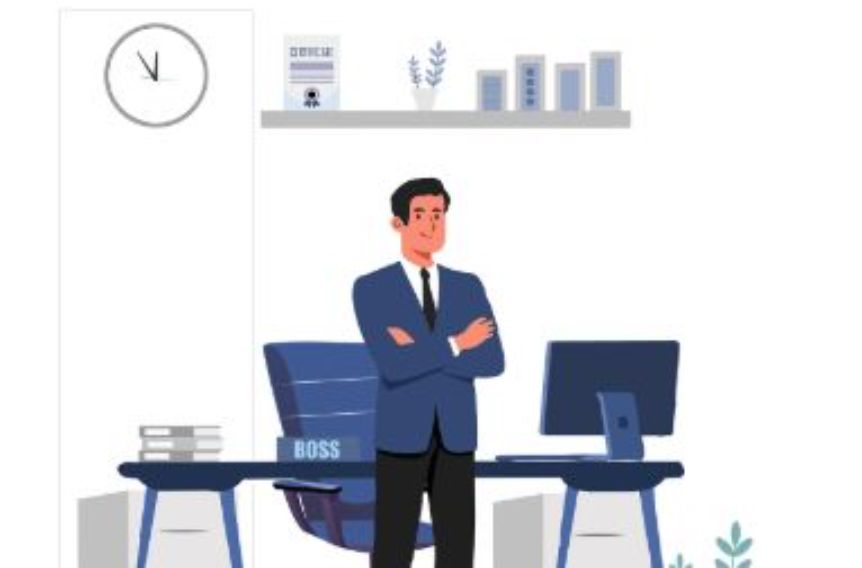

**Ghi chú thuyết trình:**

Nguồn cập nhật: https://blog.google/innovation-and-ai/products/gemini-notebook/notebooklm-gemini-notebook/ ; https://support.google.com/gemininotebook/answer/16206563?hl=en ; https://support.google.com/gemininotebook/answer/16757456?hl=en . Đối chiếu ngày 13/11/2026. Bản trình bày được mô tả là bộ slide; tài liệu trợ giúp hiện nêu xuất PDF, không khẳng định xuất PPTX trực tiếp.

---
## Slide 07 — So sánh đối tượng sử dụng
**Phần:** Phần II: Nghiên cứu thị trường và đối thủ cạnh tranh

### Notion AI

- Đối tượng: Tổ chức, Doanh nghiệp
- Chia sẻ: Phân quyền linh hoạt theo workspace
- Làm việc nhóm: Phối hợp real-time

### Gemini Notebook

- Đối tượng: Cá nhân, nhóm nghiên cứu và tổ chức.
- Chia sẻ: Mời người xem hoặc người chỉnh sửa notebook.
- Làm việc nhóm: Cùng khai thác bộ nguồn; không thay thế công cụ quản lý dự án.

### Lark

- Đối tượng: Doanh nghiệp, tổ chức
- Chia sẻ: Chia sẻ và phân quyền tài liệu trong workspace
- Làm việc nhóm: Phối hợp real-time (Docs, Chat, Meeting, Task)

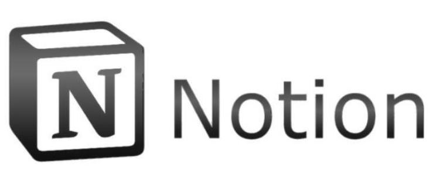

**Ghi chú thuyết trình:**

Nguồn cập nhật: https://blog.google/innovation-and-ai/products/gemini-notebook/notebooklm-gemini-notebook/ ; https://support.google.com/gemininotebook/answer/16206563?hl=en ; https://support.google.com/gemininotebook/answer/16757456?hl=en . Đối chiếu ngày 13/11/2026. Bản trình bày được mô tả là bộ slide; tài liệu trợ giúp hiện nêu xuất PDF, không khẳng định xuất PPTX trực tiếp.

---
## Slide 08 — Notion: không gian làm việc linh hoạt và tùy biến
**Phần:** Phần II: Nghiên cứu thị trường và đối thủ cạnh tranh

Notion kết hợp ghi chú, quản lý dự án và tài liệu trong một không gian có thể tùy biến theo nhu cầu.

### Không gian làm việc tùy biến

Tổ chức Wiki, dự án và tài liệu trên cùng nền tảng, phù hợp với cách làm việc của từng cá nhân hoặc nhóm.

### Database liên kết

Liên kết các trang và dữ liệu để tổ chức thông tin có cấu trúc, thay vì chỉ lưu các ghi chú rời rạc.

### Nhiều cách hiển thị

Trình bày cùng dữ liệu dưới các dạng Kanban, Calendar, Table hoặc Gallery theo mục đích sử dụng.

Tùy biến cách tổ chức và hiển thị giúp một nền tảng phục vụ nhiều nhu cầu công việc.

**Ghi chú thuyết trình:**

Notion được giới thiệu như một không gian làm việc kết hợp ghi chú, dự án và tài liệu. Hai năng lực nổi bật là tổ chức không gian tùy chỉnh và database liên kết với nhiều cách hiển thị.

---
## Slide 09 — Hệ sinh thái của Notion AI: Hơn cả một ứng dụng ghi chú
**Phần:** Phần II: Nghiên cứu thị trường và đối thủ cạnh tranh

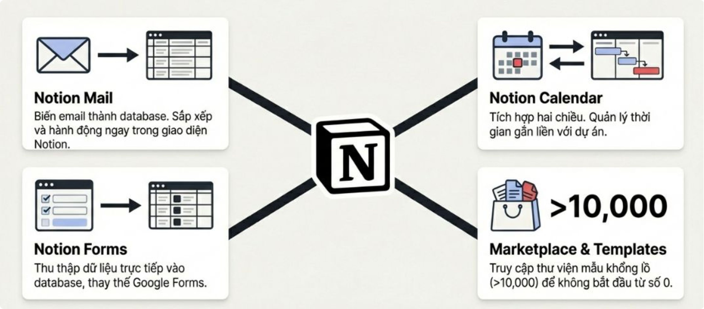

---
## Slide 10 — Notion AI: Trợ lý AI trong từng dòng chữ
**Phần:** Phần II: Nghiên cứu thị trường và đối thủ cạnh tranh

### Nội dung chính

- Q&A: Hỏi đáp trên toàn bộ workspace (bao gồm cả Slack/Google Drive được kết nối). Ví dụ: “Chính sách làm việc tại nhà nằm ở đâu?”
- Viết & Chỉnh sửa: Thay đổi giọng văn (Tone), sửa lỗi ngữ pháp, dịch thuật, viết tiếp.
- Database Autofill: Tự động tóm tắt hoặc trích xuất action items từ meeting notes vào cột dữ liệu.

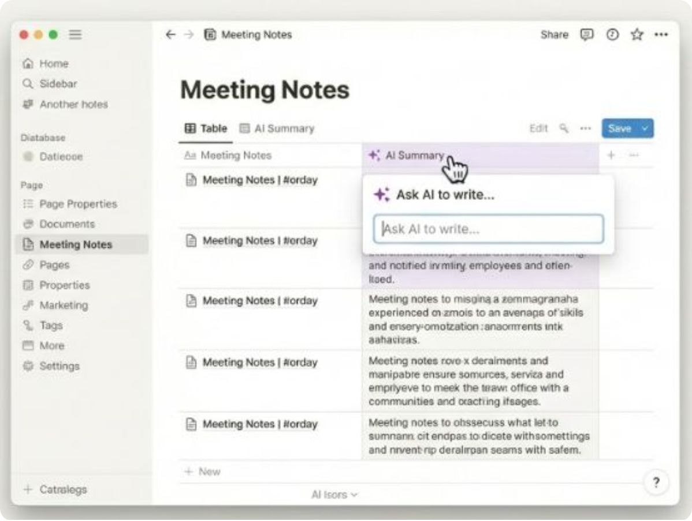

---
## Slide 11 — Notion AI: minh họa trải nghiệm trên thiết bị di động
**Phần:** Phần II: Nghiên cứu thị trường và đối thủ cạnh tranh

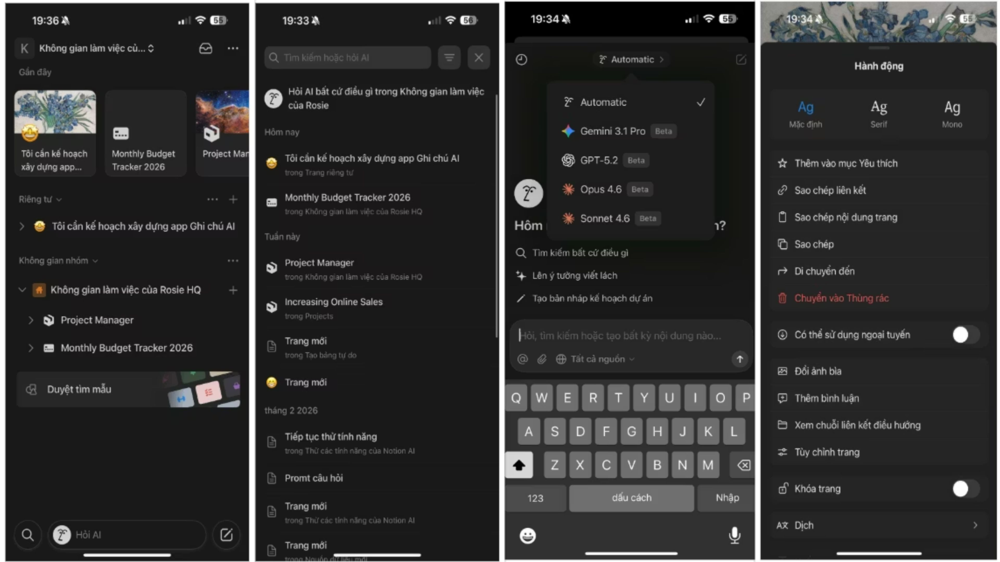

---
## Slide 12 — 3 Kịch bản "Ăn Tiền" nhất của Notion AI
**Phần:**

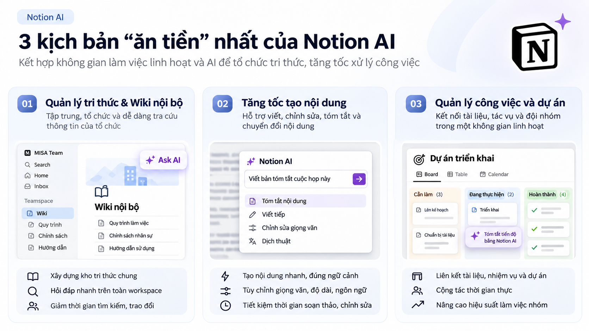

---
## Slide 13 — Gemini Notebook: tổng quan tính năng
**Phần:**

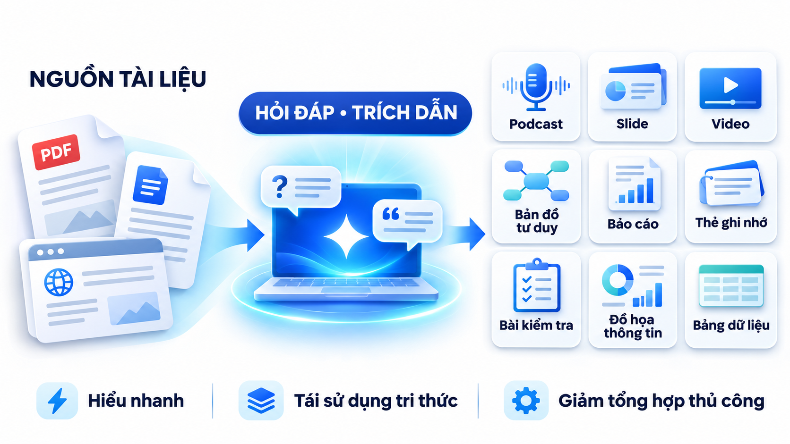

**Ghi chú thuyết trình:**

Minh họa khái quát luồng nguồn tài liệu → hỏi đáp có trích dẫn → 9 đầu ra Studio. Ảnh tạo bằng image_gen. Slide hiển thị tiêu đề và hình minh họa, không có đoạn diễn giải.

---
## Slide 14 — Gemini Notebook: nội dung và truyền đạt bằng AI
**Phần:** Phần II: Nghiên cứu thị trường và đối thủ cạnh tranh

### Nội dung chính

- Podcast & video: Truyền đạt, đào tạo nội bộ; nghe hoặc xem nhanh ý chính từ nguồn.
- Bản trình bày: Tạo bản nháp slide để chuẩn bị họp, báo cáo và thuyết trình.
- Bản đồ tư duy: Hệ thống hóa chủ đề, nhận diện quan hệ và lập dàn ý.
- Báo cáo: Tổng hợp nhiều nguồn thành bản nháp phục vụ công việc.
- Giá trị: Tái sử dụng tri thức từ cùng bộ nguồn cho nhiều mục đích; hỗ trợ đào tạo, truyền đạt và giảm công sức chuẩn bị nội dung.

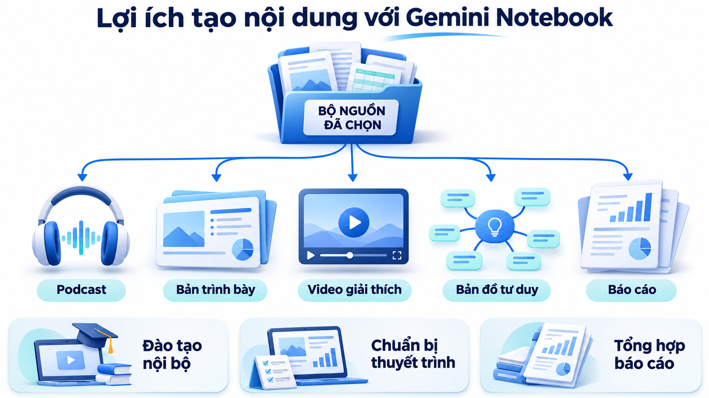

**Ghi chú thuyết trình:**

Nguồn cập nhật: https://blog.google/innovation-and-ai/products/gemini-notebook/notebooklm-gemini-notebook/ ; https://support.google.com/gemininotebook/answer/16206563?hl=en ; https://support.google.com/gemininotebook/answer/16757456?hl=en . Đối chiếu ngày 13/11/2026. Bản trình bày được mô tả là bộ slide; tài liệu trợ giúp hiện nêu xuất PDF, không khẳng định xuất PPTX trực tiếp.

Kết luận: Các dạng đầu ra AI giúp tái sử dụng cùng bộ nguồn cho đào tạo, thuyết trình và báo cáo; người dùng giảm thao tác tổng hợp, định dạng và tạo nội dung từ đầu, đồng thời vẫn cần rà soát độ chính xác và sự phù hợp.

---
## Slide 15 — Gemini Notebook: học liệu và dữ liệu bằng AI
**Phần:**

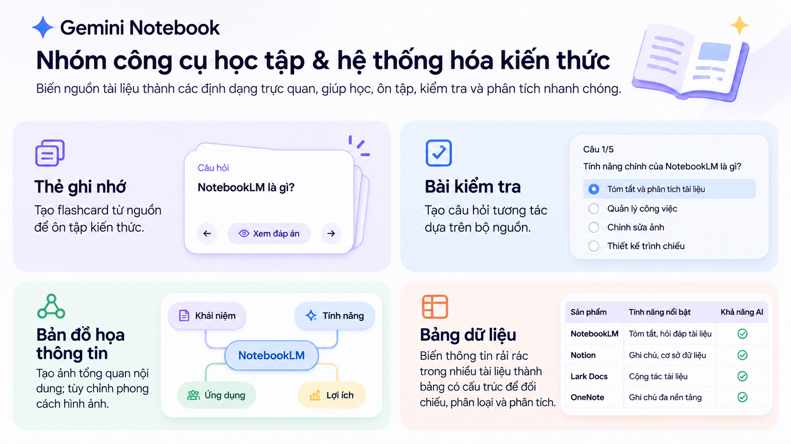

**Ghi chú thuyết trình:**

Nguồn cập nhật: https://blog.google/innovation-and-ai/products/gemini-notebook/notebooklm-gemini-notebook/ ; https://support.google.com/gemininotebook/answer/16206563?hl=en ; https://support.google.com/gemininotebook/answer/16757456?hl=en . Đối chiếu ngày 13/11/2026. Bản trình bày được mô tả là bộ slide; tài liệu trợ giúp hiện nêu xuất PDF, không khẳng định xuất PPTX trực tiếp.

---
## Slide 16 — Ví dụ - Đồ họa thông tin: từ báo cáo đến ảnh tổng quan
**Phần:** Phần II: Nghiên cứu thị trường và đối thủ cạnh tranh

### Nội dung chính

- Đầu vào: Các nguồn được chọn và yêu cầu về nội dung cần tổng hợp.
- Tùy chỉnh: Mô tả phong cách hình ảnh và trọng tâm trình bày mong muốn.
- Đầu ra: Ảnh tổng quan giúp truyền đạt ý chính và mối liên hệ trực quan.
- Minh họa: Tổng hợp hiện trạng, đối thủ, định vị và lộ trình MISA Note trong một đồ họa.

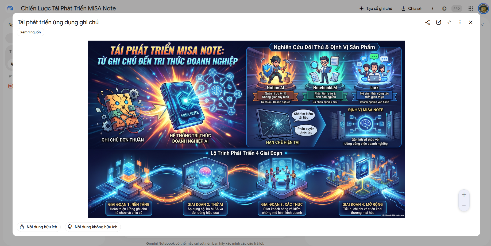

**Ghi chú thuyết trình:**

Nguồn cập nhật: https://blog.google/innovation-and-ai/products/gemini-notebook/notebooklm-gemini-notebook/ ; https://support.google.com/gemininotebook/answer/16206563?hl=en ; https://support.google.com/gemininotebook/answer/16757456?hl=en . Đối chiếu ngày 13/11/2026. Bản trình bày được mô tả là bộ slide; tài liệu trợ giúp hiện nêu xuất PDF, không khẳng định xuất PPTX trực tiếp.

---
## Slide 17 — Ví dụ - Bảng dữ liệu: tổng hợp nhiều nguồn có cấu trúc
**Phần:** Phần II: Nghiên cứu thị trường và đối thủ cạnh tranh

### Nội dung chính

- Gom thông tin nằm rải rác trong nhiều tài liệu thành một bảng có cấu trúc.
- Tùy chỉnh yêu cầu về hàng, cột và nội dung cần tổng hợp.
- Đối chiếu, phân loại và phân tích dữ liệu mà không phải tổng hợp thủ công.
- Xuất sang Google Trang tính để tiếp tục xử lý.
- Minh họa: So sánh sản phẩm theo đối tượng, tính năng AI, phối hợp và ưu điểm.

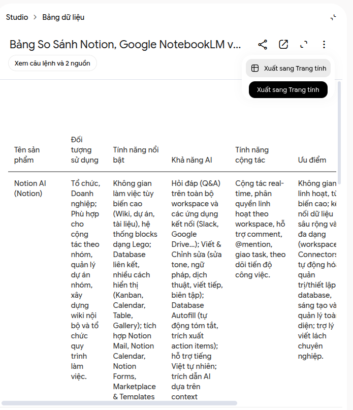

**Ghi chú thuyết trình:**

Nguồn cập nhật: https://blog.google/innovation-and-ai/products/gemini-notebook/notebooklm-gemini-notebook/ ; https://support.google.com/gemininotebook/answer/16206563?hl=en ; https://support.google.com/gemininotebook/answer/16757456?hl=en . Đối chiếu ngày 13/11/2026. Bản trình bày được mô tả là bộ slide; tài liệu trợ giúp hiện nêu xuất PDF, không khẳng định xuất PPTX trực tiếp.

---
## Slide 18 — Lark: hệ sinh thái làm việc tích hợp
**Phần:** Phần II: Nghiên cứu thị trường và đối thủ cạnh tranh

### Tổng quan

Lark được biết đến là một hệ sinh thái,  tích hợp các tính năng như Chat, Meeting… Trong đó nổi bật về tính năng của Chat(messager)

---
## Slide 19 — Lark: tích hợp AI vào luồng phối hợp và xử lý công việc
**Phần:** Phần II: Nghiên cứu thị trường và đối thủ cạnh tranh

AI được tích hợp trong chat, cuộc họp và hoạt động phối hợp để hỗ trợ nhóm làm việc ngay trong môi trường quen thuộc.

### Ghi nhận và chia sẻ

Hỗ trợ ghi chú, tóm tắt nội dung thảo luận và gửi lại thông tin sau cuộc họp qua chat.

### Xử lý thông tin

Hỗ trợ viết lại nội dung, tổng hợp báo cáo và phân tích dữ liệu phục vụ công việc.

### Kết nối phối hợp

Kết nối thông tin với tài liệu và các công cụ trong hệ sinh thái để các thành viên cùng nắm bắt tiến độ, nội dung cần phối hợp.

Giảm thao tác thủ công và chuyển đổi công cụ, giúp nhóm phối hợp nhanh và đồng bộ.

**Ghi chú thuyết trình:**

Lợi ích được nhóm theo ba hoạt động: ghi nhận/chia sẻ, xử lý thông tin và phối hợp. Các ý tăng tốc công việc, nâng hiệu suất và giảm thao tác lặp được gộp vào thông điệp giá trị chung, thay vì liệt kê lặp lại.

---
## Slide 20 — Ví dụ: Tích hợp AI summary trong cuộc họp
**Phần:** Phần II: Nghiên cứu thị trường và đối thủ cạnh tranh

### Trong cuộc họp

- Cho phép bật tắt AI Summary trong cuộc họp để tạo meeting notes, biên bản cuộc họp
- Giúp tiết kiệm thời gian, hỗ trợ user ghi lại các ý tưởng, nội dung quan trọng trong buổi họp.

### Sau cuộc họp

- Sau mỗi cuộc họp, trợ lý AI sẽ gửi meeting notes qua chat messenger để user xem lại.
- Đồng thời chuyển thành dạng docs để user chỉnh sửa.

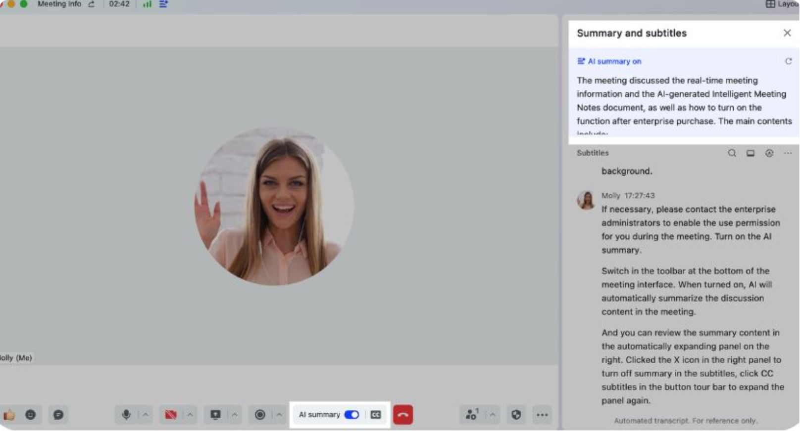

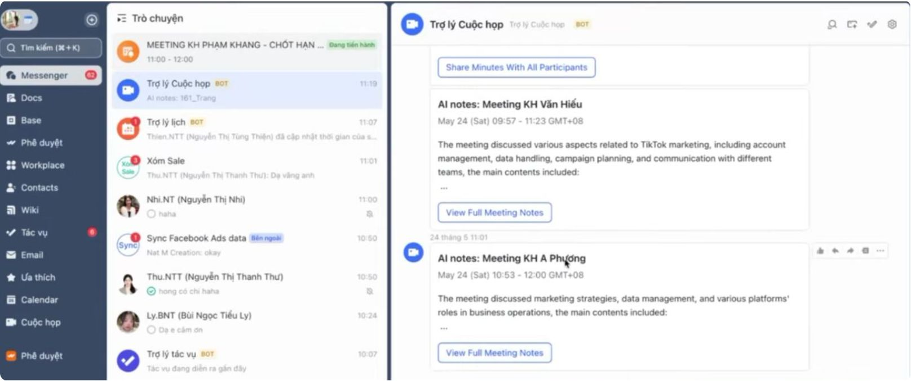

---
## Slide 21 — Điểm nổi bật của Lark Docs
**Phần:** Phần II: Nghiên cứu thị trường và đối thủ cạnh tranh

### Các tiện ích tích hợp

Một số điểm nổi bật của Lark Docs như: tích hợp sẵn nhiều template, đặc biệt là vẽ mindmap,  cây tư duy (brain-tree), Lark base ….

---
## Slide 22 — Tích hợp nhiều công cụ tiện ích
**Phần:** Phần II: Nghiên cứu thị trường và đối thủ cạnh tranh

### Nội dung chính

Lark Docs tích hợp nhiều công cụ giúp người dùng có thể nhanh chóng tạo video, lưu đồ, mind map hay bảng tính (sheets) ngay trực tiếp trong tài liệu mà không cần sử dụng thêm các công cụ bên ngoài.

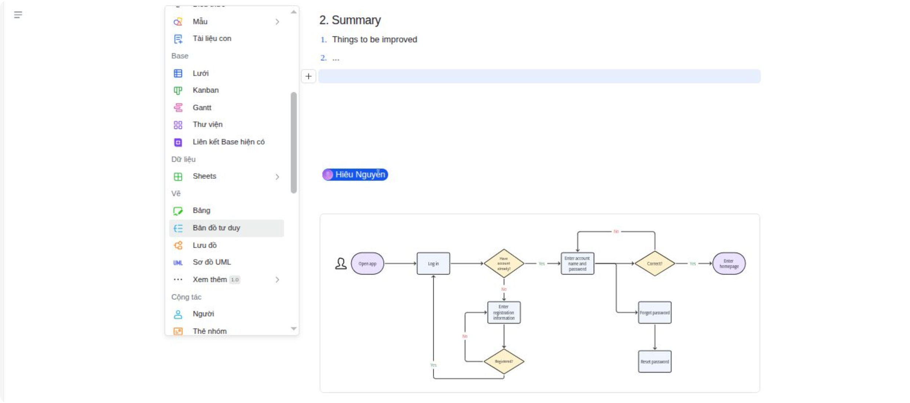

---
## Slide 23 — Tích hợp với Lark Base
**Phần:** Phần II: Nghiên cứu thị trường và đối thủ cạnh tranh

### Nội dung chính

- Lark Docs còn tích hợp với Lark Base – một công cụ trong hệ sinh thái Lark dùng để tổng hợp và phân tích dữ liệu.
- Nhờ đó, người dùng có thể chèn các bảng dữ liệu vào tài liệu một cách nhanh chóng, hỗ trợ hiệu quả cho việc làm báo cáo và nghiên cứu.

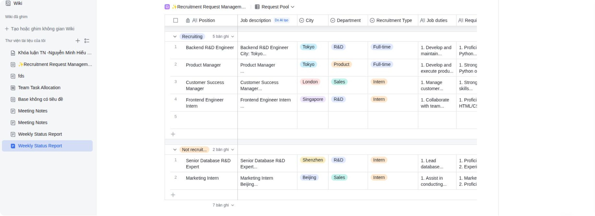

---
## Slide 24 — Tích hợp với tính năng nhắc việc và thông báo
**Phần:** Phần II: Nghiên cứu thị trường và đối thủ cạnh tranh

### Nội dung chính

Người dùng cũng có thể mention các thành viên trong nhóm ngay trong tài liệu và gửi thông báo trực tiếp cho họ, giúp việc phối hợp và trao đổi công việc trở nên thuận tiện hơn.

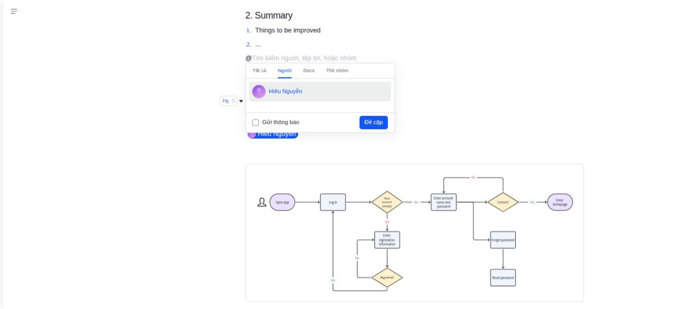

---
## Slide 25 — Tích hợp với Lark Clip
**Phần:** Phần II: Nghiên cứu thị trường và đối thủ cạnh tranh

### Nội dung chính

- Cho phép người dùng lưu một bài viết từ trình duyệt vào tài liệu Docs mà vẫn giữ nguyên định dạng ban đầu.
- Tính năng này đặc biệt hữu ích khi thu thập và lưu trữ tài liệu phục vụ cho nghiên cứu.

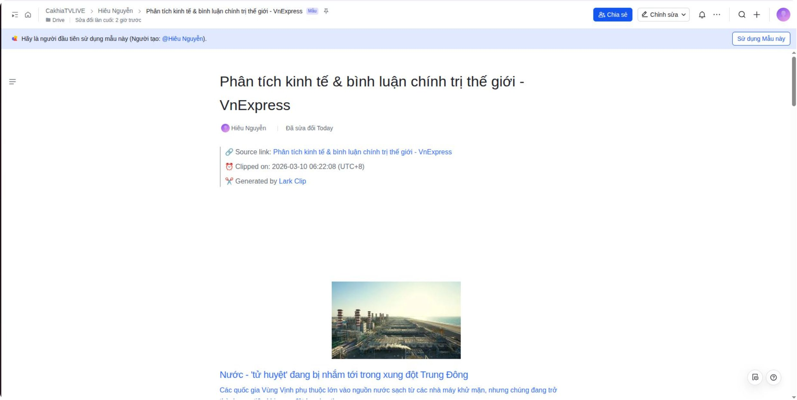

---
## Slide 26 — Bài học cho MISA: biến tài liệu thành giá trị công việc
**Phần:** Phần II: Nghiên cứu thị trường và đối thủ cạnh tranh

### 1. Tri thức dễ kế thừa

- Notion: Tổ chức tài liệu theo dự án và nhóm.
- Giá trị: Giảm tìm kiếm, hỏi lại và làm lại; hỗ trợ nhân viên mới.
- MISA: Ưu tiên cấu trúc rõ, tìm kiếm thuận tiện và chia sẻ dễ dùng.

### 2. AI giảm công tổng hợp

- Gemini Notebook: Hỏi đáp, tổng hợp và tạo nội dung từ nguồn.
- Giá trị: Giảm tổng hợp thủ công; hỗ trợ báo cáo và đào tạo.
- MISA: Ưu tiên hỏi đáp có trích dẫn, đúng quyền truy cập.

### 3. Tăng cường phối hợp và chia sẻ tri thức

- Lark: Kết hợp tài liệu, trao đổi và phối hợp trong một không gian làm việc thống nhất.
- Giá trị: Giúp các thành viên cùng xây dựng, cập nhật và sử dụng thông tin, hạn chế tài liệu phân tán và trao đổi thiếu đồng bộ.
- MISA: Phát triển khả năng cùng chỉnh sửa, bình luận và trao đổi trực tiếp trên tài liệu; hoàn thiện trải nghiệm chia sẻ và tận dụng hệ thống phân quyền hiện có.

Ưu tiên: hoàn thiện nền tảng → thử AI trên việc lặp lại → đo hiệu quả nội bộ → xem xét thương mại hóa.

**Ghi chú thuyết trình:**

Thông điệp trình bày: Nghiên cứu ba nền tảng cho thấy ba hướng tạo giá trị bổ sung cho nhau: tổ chức tri thức để tìm và kế thừa; khai thác tri thức bằng AI; đưa tri thức vào công việc thực tế. Đây là tổng hợp và đề xuất cho MISA từ các năng lực đã trình bày trong Phần II, không phải kết quả đo năng suất hoặc doanh thu của đối thủ.

1. Notion — tri thức dễ tìm, dễ kế thừa. Khi tài liệu gắn với dự án, nhóm và cấu trúc rõ ràng, người dùng có thể tiếp cận lại kiến thức thay vì tìm kiếm, hỏi đồng nghiệp hoặc làm lại. Với MISA, đây là lý do ưu tiên giải quyết hạn chế tìm kiếm và trải nghiệm chia sẻ đã nêu ở Phần I.

2. Gemini Notebook — AI giảm công xử lý thông tin. Giá trị không nằm ở số định dạng đầu ra mà ở việc giảm thao tác đọc, đối chiếu, tổng hợp và biên soạn lại. Tình huống nên thử trong MISA: hỏi đáp quy trình có trích dẫn, tổng hợp báo cáo tuần và trích xuất kết luận từ biên bản. AI chỉ khai thác tài liệu người dùng được phép truy cập; nội dung quan trọng cần được đối chiếu nguồn.

3. Lark — tài liệu đi cùng công việc. Khi kết quả cuộc họp và tài liệu liên quan được dùng tiếp trong phối hợp, ghi chú có vai trò trong quá trình thực hiện công việc. Với MISA, nên kiểm chứng các điểm kết nối có nhu cầu rõ trong luồng nội bộ trước khi mở rộng tích hợp.

Hàm ý cho quyết định đầu tư: hoàn thiện nền tảng tổ chức, tìm kiếm và chia sẻ trước; thử AI có phạm vi trên các tác vụ lặp lại; chỉ mở rộng khi có bằng chứng hiệu quả nội bộ. Không cần triển khai đồng thời toàn bộ tính năng của ba nền tảng.

Đánh giá bằng tác vụ thực tế với cùng đầu vào và tiêu chí chất lượng: thời gian tìm đúng tài liệu; thời gian hoàn thành bản tổng hợp đã rà soát; độ chính xác và khả năng kiểm tra nguồn; tỷ lệ sử dụng lại; phản hồi người dùng và chi phí phục vụ. Slide không đưa ra tỷ lệ tiết kiệm khi chưa có số liệu đo. Việc khảo sát nhu cầu, khả năng trả phí và mô hình kinh doanh thuộc bước thương mại hóa sau mục tiêu nội bộ.

Câu chuyển sang Phần III: Từ ba bài học này, cần đối chiếu năng lực hiện tại để xác định khoảng cách và cơ hội phát triển phù hợp cho MISA Note.

3. Tăng cường phối hợp và chia sẻ tri thức
• Lark: Kết hợp tài liệu, trao đổi và phối hợp trong một không gian làm việc thống nhất.
• Giá trị: Giúp các thành viên cùng xây dựng, cập nhật và sử dụng thông tin, hạn chế tài liệu phân tán và trao đổi thiếu đồng bộ.
• MISA: Phát triển khả năng cùng chỉnh sửa, bình luận và trao đổi trực tiếp trên tài liệu; hoàn thiện trải nghiệm chia sẻ và tận dụng hệ thống phân quyền hiện có.

---
## Slide 27 — Phần III: Phân tích năng lực cạnh tranh và cơ hội phát triển
**Phần:** Phần III: Phân tích năng lực cạnh tranh và cơ hội phát triển

### Phạm vi

Đối chiếu các năng lực cốt lõi với đối thủ để xác định khoảng cách cạnh tranh, cơ hội khác biệt hóa và định vị phù hợp cho MISA Note.

---
## Slide 28 — So sánh tổng quan theo nhu cầu và năng lực
**Phần:** Phần III: Phân tích năng lực cạnh tranh và cơ hội phát triển

| Tính năng | Gemini Notebook | Notion | Lark |
| --- | --- | --- | --- |
| Nhu cầu chính | Nghiên cứu và phân tích nguồn | Sáng tạo và quản lý thông tin | Phối hợp và vận hành |
| Nguồn dữ liệu | ✔ Upload (PDF, Docs, Web) | ✔ Workspace & Connected Apps | ✔ Chat, Base, Meeting |
| Trích dẫn (Citations) | ✔ Có (Chính xác cao) | ✖ Không (Dựa trên context) | ✖ Không trực tiếp (AI dựa trên dữ liệu cuộc họp) |
| Định dạng đầu ra | 9 đầu ra Studio: podcast, slide, video, sơ đồ, báo cáo, thẻ, quiz, infographic, bảng | ✔ Văn bản, Bảng, Code, Database | ✔ Chat summary, Meeting notes |
| Chi phí | Miễn phí và các gói nâng cấp | $ Freemium + ~$10/tháng cho AI | $ Freemium + gói doanh nghiệp |
| Độ khó | 😊 Dễ (giao diện đơn giản) | 😐 Trung bình (cần học cách setup) | 😊 Trung bình (tích hợp sẵn nhiều công cụ) |
**Ghi chú thuyết trình:**

Nguồn cập nhật: https://blog.google/innovation-and-ai/products/gemini-notebook/notebooklm-gemini-notebook/ ; https://support.google.com/gemininotebook/answer/16206563?hl=en ; https://support.google.com/gemininotebook/answer/16757456?hl=en . Đối chiếu ngày 13/11/2026. Bản trình bày được mô tả là bộ slide; tài liệu trợ giúp hiện nêu xuất PDF, không khẳng định xuất PPTX trực tiếp.

---
## Slide 29 — So sánh: Nghiên cứu và Phân tích
**Phần:** Phần III: Phân tích năng lực cạnh tranh và cơ hội phát triển

### Gemini Notebook: Deep Dives

- Tốt nhất khi: Phân tích sâu một tập hợp tài liệu cụ thể (luận văn, báo cáo, tài liệu nghiên cứu).
- Lý do: Có hệ thống trích dẫn nguồn và có thể xử lý nhiều nguồn tài liệu cùng lúc (PDF, Docs, Web).

### Notion: Broad Knowledge

- Tốt nhất khi: Tìm kiếm và quản lý thông tin rải rác trong nhiều dự án hoặc wiki kiến thức của cá nhân/doanh nghiệp.
- Lý do: Kết nối dữ liệu từ workspace và nhiều ứng dụng, hỗ trợ quản lý kiến thức, database và hệ thống tài liệu.

### Lark: Team Collaboration

- Tốt nhất khi: Làm việc nhóm, giao tiếp, họp nội bộ và quản lý chung trong tổ chức hoặc doanh nghiệp.
- Lý do: Nền tảng all-in-one tích hợp chat, tài liệu, họp video, lịch và quản lý công việc, giúp phối hợp và chia sẻ thông tin theo thời gian thực.

**Ghi chú thuyết trình:**

Nguồn cập nhật: https://blog.google/innovation-and-ai/products/gemini-notebook/notebooklm-gemini-notebook/ ; https://support.google.com/gemininotebook/answer/16206563?hl=en ; https://support.google.com/gemininotebook/answer/16757456?hl=en . Đối chiếu ngày 13/11/2026. Bản trình bày được mô tả là bộ slide; tài liệu trợ giúp hiện nêu xuất PDF, không khẳng định xuất PPTX trực tiếp.

---
## Slide 30 — So sánh: Quản lý và phối hợp
**Phần:** Phần III: Phân tích năng lực cạnh tranh và cơ hội phát triển

| Nền tảng | Vai trò chính | Đặc điểm | Phù hợp |
| --- | --- | --- | --- |
| Gemini Notebook | Khai thác tri thức từ nguồn | Chia sẻ notebook với quyền Viewer/Editor; cùng khai thác nguồn và đầu ra AI, không quản lý dự án. | Nghiên cứu, học tập và tổng hợp tài liệu theo nhóm. |
| Notion | Phối hợp theo nhóm, doanh nhiệp | Hỗ trợ comment, @mention, giao task, theo dõi tiến độ theo thời gian thực. Có thể xây dựng database, wiki và workflow cho nhóm. | Quản lý dự án nhóm, xây dựng wiki nội bộ và tổ chức quy trình làm việc. |
| Lark | Phối hợp doanh nghiệp | Tích hợp chat, tài liệu, họp video, lịch và quản lý công việc trong một nền tảng (khá giống hệ sinh thái Amis). Hỗ trợ phối hợp real-time và giao tiếp nội bộ. | Làm việc nhóm, quản lý dự án và vận hành công việc trong tổ chức/doanh nghiệp. |
**Ghi chú thuyết trình:**

Nguồn cập nhật: https://blog.google/innovation-and-ai/products/gemini-notebook/notebooklm-gemini-notebook/ ; https://support.google.com/gemininotebook/answer/16206563?hl=en ; https://support.google.com/gemininotebook/answer/16757456?hl=en . Đối chiếu ngày 13/11/2026. Bản trình bày được mô tả là bộ slide; tài liệu trợ giúp hiện nêu xuất PDF, không khẳng định xuất PPTX trực tiếp.

---
## Slide 31 — So sánh: Viết lách và sáng tạo
**Phần:** Phần III: Phân tích năng lực cạnh tranh và cơ hội phát triển

### Gemini Notebook: Tạo nội dung từ nguồn

Tạo báo cáo, bản trình bày, video, podcast, đồ họa thông tin và bảng dữ liệu dựa trên bộ nguồn đã chọn.

### Notion: Người viết nháp & Biên tập

Hỗ trợ AI viết blog, email, social post; brainstorm ý tưởng, chỉnh sửa và thay đổi văn phong.

### Lark: Thư ký

Hỗ trợ tóm tắt hội thoại bằng AI trong meeting, gửi lại cho người dùng sau mỗi buổi họp quan trọng

**Ghi chú thuyết trình:**

Nguồn cập nhật: https://blog.google/innovation-and-ai/products/gemini-notebook/notebooklm-gemini-notebook/ ; https://support.google.com/gemininotebook/answer/16206563?hl=en ; https://support.google.com/gemininotebook/answer/16757456?hl=en . Đối chiếu ngày 13/11/2026. Bản trình bày được mô tả là bộ slide; tài liệu trợ giúp hiện nêu xuất PDF, không khẳng định xuất PPTX trực tiếp.

---
## Slide 32 — So sánh: Khả năng hỗ trợ tiếng Việt
**Phần:** Phần III: Phân tích năng lực cạnh tranh và cơ hội phát triển

### NOTION AI
Viết và chỉnh sửa mượt mà

- Hỗ trợ viết và chỉnh sửa tiếng Việt tự nhiên.
- Giao diện tích hợp trực tiếp trong không gian làm việc giúp soạn thảo, chỉnh sửa và quản lý tài liệu liền mạch.

### Gemini Notebook
Phân tích & tổng hợp tài liệu

- Xuất sắc trong phân tích tài liệu tiếng Việt (PDF, Docs), xử lý tốt văn bản chuyên ngành
- Có thể tạo podcast từ tài liệu nhưng ngữ điệu tiếng Việt đôi khi chưa thực sự tự nhiên như Tiếng Anh

### LARK AI
Soạn thảo & phối hợp nhóm

- Hỗ trợ tóm tắt cuộc họp và cải thiện văn bản.
- Cho phép chuyển đổi sang Tiếng Việt nhưng ngôn ngữ chưa được tự nhiên

**Ghi chú thuyết trình:**

Nguồn cập nhật: https://blog.google/innovation-and-ai/products/gemini-notebook/notebooklm-gemini-notebook/ ; https://support.google.com/gemininotebook/answer/16206563?hl=en ; https://support.google.com/gemininotebook/answer/16757456?hl=en . Đối chiếu ngày 13/11/2026. Bản trình bày được mô tả là bộ slide; tài liệu trợ giúp hiện nêu xuất PDF, không khẳng định xuất PPTX trực tiếp.

---
## Slide 33 — Khi nào dùng công cụ nào ?
**Phần:** Phần III: Phân tích năng lực cạnh tranh và cơ hội phát triển

### Gemini Notebook: Nghiên cứu chuyên sâu

- Phù hợp khi cần phân tích, tổng hợp và đối chiếu nhiều tài liệu.
- Hỏi đáp có trích dẫn để kiểm tra với nguồn.
- Tạo nội dung, học liệu và bảng dữ liệu bằng 9 công cụ Studio.

### Notion AI: Sáng tạo & Quản lý toàn diện

- Mạnh trong việc viết lại, tóm tắt, và chỉnh sửa nội dung văn bản.
- Công cụ đắc lực cho quản lý dự án, xây dựng database và wiki.
- Hỗ trợ phối hợp hiệu quả trong không gian làm việc.

### Lark: Phối hợp & Vận hành doanh nghiệp

- Giải pháp tích hợp cho phối hợp nhóm, quản lý task, lịch và quy trình làm việc.
- Hỗ trợ  tóm tắt cuộc họp trong môi trường làm việc tập trung.
- Phù hợp cho các tổ chức cần một nền tảng all-in-one để vận hành hiệu quả.

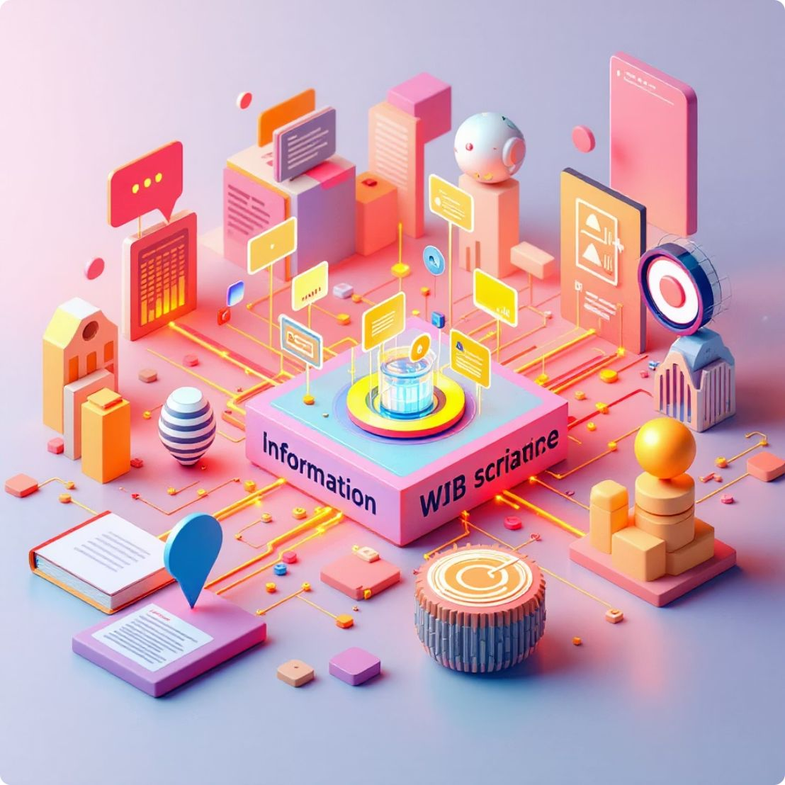

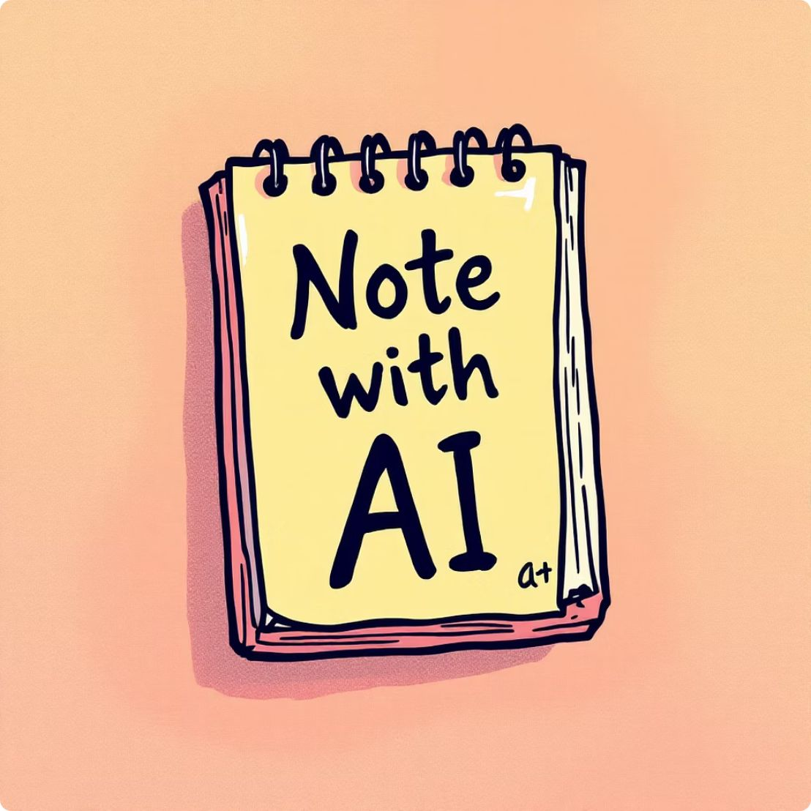

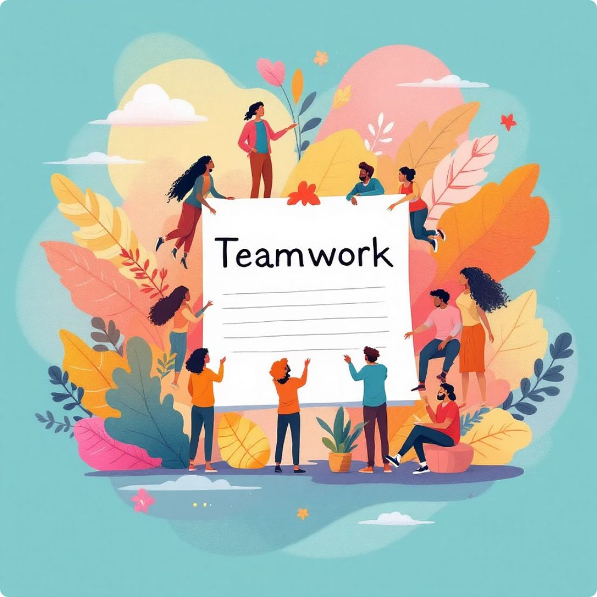

**Ghi chú thuyết trình:**

Nguồn cập nhật: https://blog.google/innovation-and-ai/products/gemini-notebook/notebooklm-gemini-notebook/ ; https://support.google.com/gemininotebook/answer/16206563?hl=en ; https://support.google.com/gemininotebook/answer/16757456?hl=en . Đối chiếu ngày 13/11/2026. Bản trình bày được mô tả là bộ slide; tài liệu trợ giúp hiện nêu xuất PDF, không khẳng định xuất PPTX trực tiếp.

---
## Slide 34 — Khoảng cách cần ưu tiên: tìm được, chia sẻ được, rồi khai thác bằng AI
**Phần:** Phần III: Phân tích năng lực cạnh tranh và cơ hội phát triển

| Năng lực | Trọng tâm đánh giá | Khoảng cách cần giải quyết | Ưu tiên |
| --- | --- | --- | --- |
| Tìm kiếm | Người đề xuất phản ánh khó tìm | Đo tác vụ; tổ chức và tìm kiếm rõ ràng | Nội bộ trước |
| Chia sẻ / quyền | Người đề xuất phản ánh khó dùng | Quyền dễ hiểu và được thực thi thật | Nội bộ trước |
| Ghi chú / quản lý | Chuẩn hóa luồng tạo và tổ chức tài liệu | Lưu bền vững; ổn định; kiểm thử dùng thật | MVP nội bộ |
| AI / tích hợp | Khai thác tri thức bằng AI | Nguồn đúng quyền; chất lượng; chi phí | Thử có kiểm soát |
Đánh giá khoảng cách bằng tác vụ thực tế, không chỉ bằng bảng có/không tính năng.

**Ghi chú thuyết trình:**

Đánh giá từng năng lực theo nhu cầu công việc, trải nghiệm sử dụng và yêu cầu vận hành để xác định thứ tự ưu tiên phát triển.

---
## Slide 35 — Định vị MISA Note gắn tri thức với công việc của doanh nghiệp Việt Nam
**Phần:** Phần III: Phân tích năng lực cạnh tranh và cơ hội phát triển

### Ghi chú và tài liệu

Một nơi để tạo, tổ chức và tìm lại tri thức công việc.

### Chia sẻ dễ hiểu

Người dùng biết tài liệu ở đâu, ai được xem và ai được sửa.

### AI theo nguồn được phép

Hỏi đáp, tổng hợp, tái sử dụng thông tin cùng đường dẫn nguồn.

Nền tảng ghi chú và tri thức cho MISA trước, mở rộng khi có bằng chứng nhu cầu.

**Ghi chú thuyết trình:**

Định vị đề xuất: MISA Note giúp nhân viên tạo lập, tìm kiếm, chia sẻ và khai thác tri thức phục vụ công việc. Không cạnh tranh bằng cách sao chép toàn bộ Notion hay xây lại hệ sinh thái Lark. Khác biệt gắn nghiệp vụ và tích hợp MISA là giả thuyết cần xác thực.

---
## Slide 36 — Phần IV — Chiến lược và lộ trình phát triển MISA Note
**Phần:** Phần IV: Chiến lược và lộ trình phát triển sản phẩm

Từ kết quả đánh giá sản phẩm hiện tại và nghiên cứu các nền tảng hàng đầu, MISA Note cần được phát triển theo một định hướng rõ ràng: hoàn thiện năng lực ghi chú và quản lý tài liệu, đồng thời từng bước ứng dụng AI để nâng cao giá trị khai thác tri thức.

Chiến lược tập trung vào hai mục tiêu: xây dựng sản phẩm đáp ứng hiệu quả nhu cầu nội bộ MISA và tạo nền tảng để phát triển thành giải pháp thương mại dành cho doanh nghiệp.

**Ghi chú thuyết trình:**

## **SLIDE 37 — PHẦN IV: CHIẾN LƯỢC VÀ LỘ TRÌNH PHÁT TRIỂN SẢN PHẨM**

**Tiêu đề:** Phần IV — Chiến lược và lộ trình phát triển MISA Note

**Nội dung giới thiệu:**

Từ kết quả đánh giá sản phẩm hiện tại và nghiên cứu các nền tảng hàng đầu, MISA Note cần được phát triển theo một định hướng rõ ràng: **hoàn thiện năng lực ghi chú và quản lý tài liệu, đồng thời từng bước ứng dụng AI để nâng cao giá trị khai thác tri thức.**

Chiến lược tập trung vào hai mục tiêu: xây dựng sản phẩm đáp ứng hiệu quả nhu cầu nội bộ MISA và tạo nền tảng để phát triển thành giải pháp thương mại dành cho doanh nghiệp.

---
## Slide 37 — Định hướng chiến lược: từ ghi chú đến khai thác tri thức bằng AI
**Phần:** Phần IV: Chiến lược và lộ trình phát triển sản phẩm

Phát triển theo bốn năng lực kế thừa, từ quản lý thông tin đến khai thác và tái sử dụng tri thức bằng AI.

| Năng lực chiến lược | Định hướng phát triển | Giá trị mang lại |
| --- | --- | --- |
| 1. Ghi chú và quản lý tài liệu | Tạo lập, chỉnh sửa, tổ chức, tìm kiếm và chia sẻ tài liệu trong một không gian thống nhất. | Nền tảng quản lý thông tin cho công việc hằng ngày. |
| 2. AI tìm kiếm và hỏi đáp tri thức | Tìm kiếm ngữ nghĩa; trả lời dựa trên tài liệu, kèm trích dẫn nguồn. | Rút ngắn thời gian tìm kiếm, tiếp cận đúng thông tin. |
| 3. AI phân tích và tổng hợp tài liệu | Phân tích một hoặc nhiều tài liệu; tổng hợp, so sánh và xác định điểm quan trọng. | Chuyển thông tin lớn thành nội dung phục vụ công việc và quyết định. |
| 4. AI tạo nội dung đa định dạng | Chuyển tri thức thành báo cáo, bản trình bày, sơ đồ tư duy hoặc âm thanh. | Tái sử dụng thông tin, giảm công sức tạo nội dung từ đầu. |
Bài học: Notion — tổ chức linh hoạt; Gemini Notebook — khai thác tài liệu bằng AI; Lark — kết nối tài liệu và phối hợp.

Ghi chú tạo ra tri thức; AI giúp khai thác tri thức hiệu quả hơn.

**Ghi chú thuyết trình:**

**Thông điệp chính:** MISA Note cần phát triển theo bốn năng lực có tính kế thừa, từ quản lý thông tin cơ bản đến khai thác và tái sử dụng tri thức bằng AI.

| Năng lực chiến lược | Định hướng phát triển | Giá trị mang lại |
| --- | --- | --- |
| 1. Ghi chú và quản lý tài liệu | Cho phép người dùng tạo lập, chỉnh sửa, tổ chức, tìm kiếm và chia sẻ tài liệu trong một không gian thống nhất. | Hình thành nền tảng quản lý thông tin phục vụ công việc hằng ngày. |
| 2. AI tìm kiếm và hỏi đáp tri thức | Tìm kiếm theo ngữ nghĩa, trả lời câu hỏi dựa trên tài liệu và cung cấp trích dẫn nguồn. | Rút ngắn thời gian tìm kiếm, giúp người dùng tiếp cận đúng thông tin cần thiết. |
| 3. AI phân tích và tổng hợp tài liệu | Phân tích một hoặc nhiều tài liệu, tổng hợp nội dung, so sánh thông tin và xác định các điểm quan trọng. | Chuyển khối lượng thông tin lớn thành nội dung có giá trị cho công việc và ra quyết định. |
| 4. AI tạo nội dung đa định dạng | Chuyển đổi tri thức từ tài liệu thành báo cáo, bản trình bày, sơ đồ tư duy hoặc nội dung âm thanh. | Tăng khả năng tái sử dụng thông tin, giảm công sức tạo nội dung từ đầu. |

**Cơ sở lựa chọn:** Kết quả nghiên cứu Notion cho thấy vai trò của tổ chức thông tin linh hoạt; Gemini Notebook nổi bật ở khả năng khai thác tài liệu bằng AI; Lark thể hiện giá trị của việc kết nối tài liệu với hoạt động phối hợp. MISA Note có thể kết hợp những bài học này theo lộ trình phù hợp với năng lực và nhu cầu thực tế.

**Kết luận:** Quản lý ghi chú là nền tảng để người dùng tạo ra tri thức; AI là hướng phát triển giúp khai thác tri thức đó hiệu quả hơn.

Nguồn cập nhật: https://blog.google/innovation-and-ai/products/gemini-notebook/notebooklm-gemini-notebook/ ; https://support.google.com/gemininotebook/answer/16206563?hl=en ; https://support.google.com/gemininotebook/answer/16757456?hl=en . Đối chiếu ngày 13/11/2026. Bản trình bày được mô tả là bộ slide; tài liệu trợ giúp hiện nêu xuất PDF, không khẳng định xuất PPTX trực tiếp.

---
## Slide 38 — Mục tiêu 1: công cụ làm việc thiết yếu trong nội bộ MISA
**Phần:** Phần IV: Chiến lược và lộ trình phát triển sản phẩm

Trước khi thương mại hóa, MISA Note cần chứng minh giá trị sử dụng thực tế ngay trong môi trường MISA.

### Giải quyết hạn chế hiện tại

- Chuyển từ tiếp nhận tài liệu có sẵn sang chủ động tạo lập, quản lý và khai thác thông tin.
- Người dùng ghi lại nội dung công việc, xây dựng tài liệu, tổ chức và tìm kiếm khi cần.

### Quản lý và chia sẻ tri thức

- Tập trung tài liệu và ghi chú, giảm thông tin phân tán, khó tìm hoặc phải trao đổi nhiều lần.
- Kế thừa phân quyền hiện có; cải thiện trải nghiệm chia sẻ và kiểm soát phạm vi truy cập.

### Kiểm chứng trước khi mở rộng

Triển khai cho các nhóm người dùng nội bộ và đánh giá:
- Mức sử dụng, tỷ lệ quay lại.
- Thời gian tìm và xử lý thông tin.
- Hài lòng và phản hồi.
- Ổn định, bảo mật, vận hành.

Nội bộ là nơi hoàn thiện sản phẩm, kiểm chứng giá trị và tích lũy kinh nghiệm.

**Ghi chú thuyết trình:**

## **SLIDE 39 — MỤC TIÊU 1: XÂY DỰNG MISA NOTE THÀNH CÔNG CỤ LÀM VIỆC THIẾT YẾU TRONG NỘI BỘ**

**Thông điệp chính:** Trước khi thương mại hóa, MISA Note cần chứng minh giá trị sử dụng thực tế ngay trong môi trường MISA.

### **1. Giải quyết những hạn chế của sản phẩm hiện tại**

Chuyển từ mô hình người dùng chủ yếu tiếp nhận tài liệu có sẵn sang một nền tảng cho phép chủ động tạo lập, quản lý và khai thác thông tin.

Người dùng có thể ghi lại nội dung công việc, xây dựng tài liệu, tổ chức thông tin và tìm kiếm khi cần.

### **2. Nâng cao hiệu quả quản lý và chia sẻ tri thức nội bộ**

Tập trung tài liệu và ghi chú trong không gian làm việc có tổ chức, giảm tình trạng thông tin phân tán, khó tìm kiếm hoặc phải trao đổi nhiều lần.

Kế thừa khả năng phân quyền hiện có, đồng thời hoàn thiện trải nghiệm chia sẻ để người dùng dễ dàng phối hợp và kiểm soát phạm vi truy cập.

### **3. Kiểm chứng giá trị trước khi mở rộng**

Triển khai cho các nhóm người dùng nội bộ, đánh giá khả năng đáp ứng công việc thực tế thông qua:

- Mức độ sử dụng và tỷ lệ quay lại.
- Thời gian tìm kiếm, xử lý thông tin.
- Mức độ hài lòng và phản hồi của người dùng.
- Tính ổn định, bảo mật và khả năng vận hành.

**Kết luận:** Nội bộ MISA là môi trường để hoàn thiện sản phẩm, kiểm chứng giá trị và tích lũy kinh nghiệm trước khi tiếp cận khách hàng bên ngoài.

---
## Slide 39 — Ưu tiên hoàn thiện nền tảng ghi chú và quản lý tài liệu
**Phần:** Phần IV: Chiến lược và lộ trình phát triển sản phẩm

AI có giá trị phải dựa trên năng lực tạo lập, lưu trữ và quản lý thông tin được hoàn thiện.

### Tạo lập và chỉnh sửa

- Trình soạn thảo linh hoạt, Quick Note và hệ thống mẫu.
- Ghi lại ý tưởng, thông tin và nội dung công việc thuận tiện.

### Tổ chức thông tin

- Không gian cá nhân và nhóm; thư mục, tài liệu có cấu trúc.
- Hỗ trợ tìm kiếm và truy cập nhanh.

### Chia sẻ và phối hợp

- Kế thừa phân quyền hiện có.
- Cải thiện chia sẻ cho cá nhân, nhóm, không gian làm việc; nghiên cứu hình thức phối hợp phù hợp.

### Vận hành tin cậy

- Lưu trữ, bảo vệ dữ liệu và kiểm soát truy cập.
- Giữ hiệu năng ổn định khi người dùng và tài liệu tăng.

Một môi trường thống nhất cho toàn bộ luồng ghi chú → tổ chức → tìm kiếm → chia sẻ.

**Ghi chú thuyết trình:**

## **SLIDE 40 — ƯU TIÊN HOÀN THIỆN NỀN TẢNG GHI CHÚ VÀ QUẢN LÝ TÀI LIỆU**

**Thông điệp chính:** Muốn phát triển các năng lực AI có giá trị, MISA Note trước hết phải đáp ứng tốt nhu cầu tạo lập, lưu trữ và quản lý thông tin.

**Tạo lập và chỉnh sửa nội dung**

Phát triển trình soạn thảo tài liệu linh hoạt, ghi chú nhanh (Quick Note) và hệ thống mẫu, giúp người dùng dễ dàng ghi lại ý tưởng, thông tin và nội dung công việc.

**Tổ chức và quản lý thông tin**

Xây dựng không gian làm việc cá nhân và nhóm, quản lý thư mục, tài liệu theo cấu trúc rõ ràng, hỗ trợ tìm kiếm và truy cập nhanh.

**Chia sẻ và phối hợp**

Kế thừa tính năng phân quyền hiện có, cải thiện thao tác chia sẻ cho cá nhân, nhóm và không gian làm việc; nghiên cứu bổ sung các hình thức phối hợp phù hợp.

**Nền tảng vận hành tin cậy**

Đảm bảo khả năng lưu trữ, bảo vệ dữ liệu, kiểm soát truy cập và duy trì hiệu năng ổn định khi số lượng người dùng và tài liệu tăng.

**Giá trị kỳ vọng:** Hình thành một môi trường làm việc thống nhất, nơi người dùng có thể hoàn thành toàn bộ quá trình từ ghi chú, tổ chức, tìm kiếm đến chia sẻ tài liệu.

---
## Slide 40 — Mục tiêu 2: tạo giá trị khác biệt để hướng tới thương mại hóa
**Phần:** Phần IV: Chiến lược và lộ trình phát triển sản phẩm

Sau khi hoàn thành mục tiêu nội bộ, phát triển giá trị khác biệt để thuyết phục khách hàng doanh nghiệp lựa chọn.

### Định vị theo nhu cầu

- Không chạy đua số lượng tính năng.
- Tập trung quản lý, tìm kiếm và khai thác tri thức cho doanh nghiệp Việt Nam.

### Khác biệt dựa trên AI

Từ lưu trữ sang hỏi đáp, tổng hợp và tạo nội dung trực tiếp từ tri thức tổ chức.

### Hệ sinh thái MISA

- Nghiên cứu kết nối thông tin và tài liệu ngay trong quy trình làm việc quen thuộc.
- Đánh giá nhu cầu, kỹ thuật và hiệu quả đầu tư.

### Kiểm chứng kinh doanh

- Xác định phân khúc, bài toán thực tế và giá trị sẵn sàng trả phí.
- Thử với khách hàng phù hợp trước khi mở rộng.

Thương mại hóa cần giải pháp khác biệt, đáp ứng nhu cầu và tạo doanh thu bền vững.

**Ghi chú thuyết trình:**

## **SLIDE 41 — MỤC TIÊU 2: PHÁT TRIỂN GIÁ TRỊ KHÁC BIỆT ĐỂ HƯỚNG TỚI THƯƠNG MẠI HÓA**

**Thông điệp chính:** MISA Note cần có giá trị vượt ra ngoài một ứng dụng ghi chú thông thường để tạo lý do thuyết phục khách hàng doanh nghiệp lựa chọn sản phẩm.

### **1. Định vị sản phẩm theo nhu cầu doanh nghiệp**

Không cạnh tranh bằng số lượng tính năng với các nền tảng lớn. MISA Note tập trung giải quyết bài toán quản lý, tìm kiếm và khai thác tri thức trong môi trường làm việc của doanh nghiệp Việt Nam.

### **2. Phát triển lợi thế cạnh tranh dựa trên AI**

Thay vì chỉ lưu trữ tài liệu, MISA Note hướng tới khả năng giúp người dùng đặt câu hỏi, tổng hợp thông tin và tạo ra nội dung phục vụ công việc trực tiếp từ nguồn tri thức của tổ chức.

### **3. Khai thác tiềm năng hệ sinh thái MISA**

Nghiên cứu khả năng kết nối với các sản phẩm MISA để người dùng tiếp cận thông tin và tài liệu ngay trong quy trình làm việc quen thuộc.

Đây là cơ hội khác biệt hóa cần được kiểm chứng về nhu cầu, tính khả thi kỹ thuật và hiệu quả đầu tư.

### **4. Kiểm chứng mô hình kinh doanh**

Xác định phân khúc khách hàng mục tiêu, những bài toán có nhu cầu thực tế và giá trị khách hàng sẵn sàng chi trả. Thử nghiệm với nhóm khách hàng phù hợp trước khi quyết định mở rộng.

**Kết luận:** Thương mại hóa không đơn thuần là đưa sản phẩm nội bộ ra thị trường, mà là phát triển một giải pháp có giá trị khác biệt, đáp ứng nhu cầu và tạo được doanh thu bền vững.

---
## Slide 41 — AI tìm kiếm và hỏi đáp: biến tài liệu thành tri thức có thể khai thác
**Phần:** Phần IV: Chiến lược và lộ trình phát triển sản phẩm

Người dùng cần tìm được câu trả lời khi cần, thay vì chỉ có một nơi lưu trữ tài liệu.

### Bài toán hiện tại

- Thông tin nằm trong nhiều tài liệu.
- Người dùng phải tìm, mở và đọc từng văn bản; chi phí thời gian tăng cùng quy mô kho tài liệu.

### Giải pháp đề xuất

- Tìm kiếm theo ngữ nghĩa.
- Hỏi bằng ngôn ngữ tự nhiên.
- Tổng hợp câu trả lời từ tài liệu được phép truy cập.
- Trích dẫn và đường dẫn kiểm tra nguồn.

### Tình huống ứng dụng

- “Quy trình đề xuất và phê duyệt mua sắm thiết bị hiện tại như thế nào?”
- AI trả về các bước tóm tắt, kèm tài liệu để đối chiếu.

### Giá trị mang lại

- Giảm thời gian tra cứu.
- Tăng khả năng tiếp cận tri thức nội bộ.
- Giảm phụ thuộc vào việc hỏi người nắm thông tin.

Ưu tiên đánh giá triển khai sớm: giải quyết trực tiếp hạn chế tìm kiếm ở Phần I.

**Ghi chú thuyết trình:**

## **SLIDE 42 — AI TÌM KIẾM VÀ HỎI ĐÁP: BIẾN KHO TÀI LIỆU THÀNH NGUỒN TRI THỨC CÓ THỂ KHAI THÁC**

**Thông điệp chính:** Giá trị của tài liệu không chỉ nằm ở khả năng lưu trữ mà còn ở việc người dùng có thể tìm được câu trả lời chính xác khi cần.

### **Bài toán hiện tại**

Thông tin nằm trong nhiều tài liệu, người dùng phải tìm kiếm, mở và đọc từng tài liệu để xác định nội dung cần thiết. Quá trình này tiêu tốn thời gian, đặc biệt khi số lượng tài liệu ngày càng lớn.

### **Giải pháp đề xuất**

- Tìm kiếm theo ngữ nghĩa, không phụ thuộc hoàn toàn vào từ khóa.
- Đặt câu hỏi trực tiếp bằng ngôn ngữ tự nhiên.
- AI tổng hợp câu trả lời từ các tài liệu người dùng được phép truy cập.
- Cung cấp trích dẫn và đường dẫn để kiểm tra lại thông tin gốc.

### **Tình huống ứng dụng**

Nhân viên đặt câu hỏi: *“Quy trình đề xuất và phê duyệt mua sắm thiết bị hiện tại như thế nào?”*

Thay vì tự tìm và đọc nhiều văn bản, người dùng nhận được nội dung tóm tắt các bước thực hiện, kèm tài liệu nguồn để đối chiếu.

### **Giá trị mang lại**

Giảm thời gian tra cứu, nâng cao khả năng tiếp cận tri thức nội bộ và giảm sự phụ thuộc vào việc hỏi trực tiếp những người nắm giữ thông tin.

**Định hướng ưu tiên:** Đây là một trong những năng lực AI nên được đánh giá triển khai sớm, bởi giải quyết trực tiếp hạn chế tìm kiếm đã xác định tại Phần I.

---
## Slide 42 — AI phân tích và tổng hợp: nâng cao giá trị sử dụng tài liệu
**Phần:** Phần IV: Chiến lược và lộ trình phát triển sản phẩm

Hỗ trợ người dùng tổng hợp thông tin cần thiết cho công việc và ra quyết định, không chỉ đọc nhanh hơn.

### Bài toán người dùng

- Phải xử lý nhiều báo cáo, biên bản và tài liệu cùng vấn đề.
- Tổng hợp thủ công tốn thời gian, dễ bỏ sót thông tin quan trọng.

### Giải pháp đề xuất

- Tóm tắt tài liệu dài, tổng hợp đa nguồn.
- So sánh giống/khác giữa phiên bản.
- Trích xuất kết luận, quyết định, đầu việc.
- Tham chiếu nguồn cho nội dung quan trọng.

### Tình huống ứng dụng

- Tổng hợp kết quả từ nhiều báo cáo tuần.
- AI xây dựng báo cáo chung, chỉ ra vấn đề nổi bật, thay đổi và công việc cần theo dõi.

### Giá trị mang lại

- Giảm công tổng hợp thủ công.
- Giúp quản lý nắm bắt thông tin nhanh.
- Tăng khả năng sử dụng lại dữ liệu đã tạo.

Thử trên tài liệu có cấu trúc và tình huống rõ ràng trước khi phân tích phức tạp.

**Ghi chú thuyết trình:**

## **SLIDE 43 — AI PHÂN TÍCH VÀ TỔNG HỢP: NÂNG CAO GIÁ TRỊ SỬ DỤNG CỦA TÀI LIỆU**

**Thông điệp chính:** MISA Note hướng tới hỗ trợ người dùng không chỉ đọc tài liệu nhanh hơn mà còn tổng hợp được thông tin cần thiết để phục vụ công việc và ra quyết định.

### **Bài toán người dùng**

Trong công việc, người dùng thường phải xử lý nhiều báo cáo, biên bản và tài liệu liên quan đến cùng một vấn đề. Việc tổng hợp thủ công mất thời gian và có nguy cơ bỏ sót thông tin quan trọng.

### **Giải pháp đề xuất**

- Tóm tắt nội dung chính của tài liệu dài.
- Tổng hợp thông tin từ nhiều tài liệu.
- So sánh các điểm giống và khác nhau giữa các phiên bản.
- Trích xuất kết luận, quyết định và công việc cần thực hiện.
- Cung cấp nguồn tham chiếu cho những nội dung quan trọng.

### **Tình huống ứng dụng**

Người quản lý cần tổng hợp kết quả công việc từ nhiều báo cáo tuần.

AI hỗ trợ xây dựng báo cáo tổng hợp, xác định những vấn đề nổi bật, nội dung thay đổi và các công việc cần tiếp tục theo dõi.

### **Giá trị mang lại**

Giảm công việc tổng hợp thủ công, hỗ trợ người quản lý nắm bắt thông tin nhanh hơn và nâng cao khả năng sử dụng lại dữ liệu đã được tạo ra.

**Định hướng ưu tiên:** Thử nghiệm với những loại tài liệu có cấu trúc và tình huống sử dụng rõ ràng trước khi mở rộng sang phân tích phức tạp.

---
## Slide 43 — AI đa định dạng: mở rộng khả năng tái sử dụng tri thức
**Phần:** Phần IV: Chiến lược và lộ trình phát triển sản phẩm

Chuyển cùng một nguồn tài liệu thành nhiều hình thức truyền đạt mà không phải biên soạn lại từ đầu.

Bài toán: cùng nội dung cần biên soạn cho báo cáo, thuyết trình, đào tạo và truyền đạt thông tin.

### Báo cáo

Tổng hợp và trình bày nội dung theo cấu trúc báo cáo.

### Slide

Chuyển tài liệu thành dàn ý và nội dung thuyết trình.

### Sơ đồ tư duy

Trực quan hóa cấu trúc và mối liên hệ giữa thông tin.

### Audio

Chuyển tài liệu thành dạng nghe, thuận tiện tiếp cận.

Giá trị: tăng hiệu suất tạo nội dung, đa dạng cách tiếp cận và mở rộng tình huống sử dụng trong doanh nghiệp.

Phát triển có chọn lọc: ưu tiên đầu ra có giá trị rõ ràng và kiểm soát được chất lượng.

**Ghi chú thuyết trình:**

## **SLIDE 44 — AI ĐA ĐỊNH DẠNG: MỞ RỘNG KHẢ NĂNG TÁI SỬ DỤNG TRI THỨC**

**Thông điệp chính:** Cùng một nguồn tài liệu có thể được chuyển đổi thành nhiều hình thức truyền đạt khác nhau, phù hợp với mục đích sử dụng mà không cần xây dựng lại nội dung từ đầu.

### **Bài toán người dùng**

Một nội dung thường phải được biên soạn lại cho nhiều mục đích: báo cáo, thuyết trình, đào tạo hoặc truyền đạt thông tin. Quá trình chuyển đổi thủ công làm tăng thời gian và chi phí thực hiện.

### **Giải pháp đề xuất**

**Báo cáo**

Tổng hợp và trình bày nội dung theo cấu trúc báo cáo.

**Slide**

Chuyển tài liệu thành dàn ý và nội dung thuyết trình.

**Sơ đồ tư duy**

Trực quan hóa cấu trúc và mối liên hệ giữa các thông tin.

**Audio**

Chuyển nội dung tài liệu thành dạng nghe để tiếp cận thuận tiện hơn.

### **Giá trị mang lại**

Tăng hiệu suất tạo nội dung, đa dạng hóa cách tiếp cận tri thức và mở rộng những tình huống sử dụng MISA Note trong doanh nghiệp.

**Định hướng ưu tiên:** Phát triển có chọn lọc theo nhu cầu thực tế. Không triển khai đồng thời tất cả định dạng; ưu tiên những đầu ra có khả năng tạo giá trị rõ ràng và kiểm soát được chất lượng.

---
## Slide 44 — Lộ trình phát triển: hoàn thiện nội bộ, từng bước thương mại hóa
**Phần:** Phần IV: Chiến lược và lộ trình phát triển sản phẩm

Đầu tư theo giai đoạn, gắn kết quả sản phẩm với giá trị sử dụng và tiềm năng kinh doanh để kiểm soát rủi ro.

### 1. Hoàn thiện nền tảng

- Phát triển ghi chú, quản lý tài liệu, tìm kiếm, chia sẻ; đáp ứng vận hành nội bộ.
- Kết quả: hoàn chỉnh các luồng cốt lõi, sẵn sàng triển khai nội bộ.

### 2. Nội bộ và thử AI

- Mở rộng dùng trong MISA, nhận phản hồi, đo hiệu quả. Thử AI ứng dụng cao, ưu tiên tìm kiếm và khai thác tài liệu.
- Kết quả: bằng chứng giá trị, chất lượng và tính khả thi AI.

### 3. Xác thực thương mại

- Nghiên cứu khách hàng; chọn bài toán và pilot có kiểm soát. Đo sử dụng, hiệu quả, chi phí, khả năng trả phí.
- Kết quả: phân khúc tiềm năng, giá trị khác biệt và cơ sở mô hình kinh doanh.

### 4. Hoàn thiện và mở rộng

- Phát triển năng lực đã kiểm chứng, tối ưu chi phí, nâng tích hợp và lập kế hoạch kinh doanh.
- Kết quả: triển khai và kinh doanh bền vững nếu pilot đạt tiêu chí đầu tư.

Nguyên tắc: mỗi giai đoạn có đầu ra và tiêu chí rõ; mở rộng đầu tư theo hiệu quả thực tế, không theo kỳ vọng công nghệ.

Thống nhất hai mục tiêu: hoàn thiện nội bộ và hình thành giải pháp tri thức có thể thương mại hóa.

**Ghi chú thuyết trình:**

## **SLIDE 45 — LỘ TRÌNH PHÁT TRIỂN: HOÀN THIỆN NỘI BỘ, KIỂM CHỨNG GIÁ TRỊ, TỪNG BƯỚC THƯƠNG MẠI HÓA**

**Thông điệp chính:** Đề xuất đầu tư theo từng giai đoạn, gắn kết quả phát triển sản phẩm với giá trị sử dụng và tiềm năng kinh doanh, nhằm kiểm soát rủi ro và tối ưu nguồn lực.

1. **Giai đoạn 1 — Hoàn thiện nền tảng MISA Note**

   Phát triển các chức năng ghi chú, quản lý tài liệu, tìm kiếm và chia sẻ; đảm bảo hệ thống đáp ứng yêu cầu vận hành nội bộ.

   Kết quả kỳ vọng: Sản phẩm hoàn chỉnh các luồng sử dụng cốt lõi, sẵn sàng triển khai nội bộ.
2. **Giai đoạn 2 — Triển khai nội bộ và thử nghiệm AI**

   Mở rộng sử dụng trong MISA, thu thập phản hồi và đo lường hiệu quả. Thử nghiệm các năng lực AI có tính ứng dụng cao, ưu tiên tìm kiếm và khai thác tài liệu.

   Kết quả kỳ vọng: Có bằng chứng về giá trị sử dụng, chất lượng sản phẩm và tính khả thi của AI.
3. **Giai đoạn 3 — Xác thực nhu cầu và thử nghiệm thương mại**

   Nghiên cứu khách hàng mục tiêu, lựa chọn bài toán phù hợp và triển khai pilot có kiểm soát. Đánh giá mức độ sử dụng, hiệu quả, chi phí và khả năng trả phí.

   Kết quả kỳ vọng: Xác định được phân khúc tiềm năng, giá trị khác biệt và cơ sở xây dựng mô hình kinh doanh.
4. **Giai đoạn 4 — Hoàn thiện giải pháp và mở rộng thị trường**

   Tiếp tục phát triển những năng lực đã được kiểm chứng, tối ưu chi phí, nâng cao khả năng tích hợp và xây dựng kế hoạch kinh doanh.

   Kết quả kỳ vọng: Sản phẩm có khả năng triển khai và phát triển kinh doanh bền vững, nếu kết quả pilot đáp ứng tiêu chí đầu tư.

### **Nguyên tắc đầu tư**

Mỗi giai đoạn cần có kết quả đầu ra và tiêu chí đánh giá rõ ràng. Việc mở rộng phạm vi phát triển và đầu tư chỉ được quyết định dựa trên hiệu quả thực tế, không dựa trên kỳ vọng về công nghệ.

**Kết luận:** Đề xuất Ban lãnh đạo thống nhất định hướng phát triển MISA Note theo hai mục tiêu: hoàn thiện sản phẩm phục vụ nội bộ và từng bước hình thành giải pháp quản lý tri thức thông minh có tiềm năng thương mại hóa.
